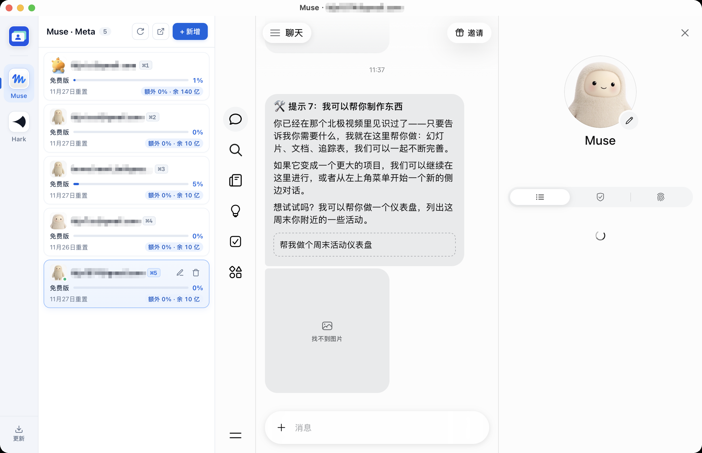

# 叠号（Multi-Agent Account Manager）

[](https://linux.do/)

基于 Tauri 2 构建的 macOS（Apple Silicon）AI 助手多账号隔离与快速切换工具，安装后应用名称为 **叠号**。自 v0.2.0 起仅保留 macOS 版；v0.4.0 起新增 TeleAgent（星辰超级智能体）服务。

## 支持服务与核心特性

| 服务 | 状态 | 说明 |
| --- | --- | --- |
| **Muse · Meta** | 已启用 | 独立会话隔离、邮箱识别、额度明细同步 |
| **TeleAgent · 星辰超级智能体** | 已启用 | 粘贴 operationToken 免登录添加、token 到期与积分/签到状态显示 |

- **原生级多账号隔离**：每个账号使用独立 UUID 的 `WKWebsiteDataStore`，Cookie 与本地存储互不干扰。
- **代理设置（仅 macOS）**：左侧栏底部「代理」可设置 `http://` / `socks5://` 代理（如 `http://127.0.0.1:7890`，需带端口，暂不支持账号密码），账号页面、登录弹窗与应用内更新均经此代理；保存后已打开的账号视图会关闭，重新打开账号时生效，清空并保存即关闭代理。需要 macOS 14.0+。
- **快捷切号**：支持 `⌘1~9` 以及 `⌘↑`/`⌘↓`/`⌘[`/`⌘]` 快速切换账号。
- **应用内检查更新**：支持在客户端内检查 GitHub Releases 最新版本、带进度条下载、`SHA-256` 校验及覆盖更新。

---

## 界面预览

### macOS

<p align="center">
  
</p>

---

## 下载与安装

前往 [GitHub Releases](https://github.com/Liberniz/multi-agent-account-manager/releases) 下载对应平台安装包：

| 平台 | 下载文件 | 架构 / 系统要求 |
| --- | --- | --- |
| macOS | `account-manager-macos-arm64.dmg` | Apple Silicon（macOS 14.0+） |

> `account-manager-macos-arm64.app.tar.gz` 仅用于应用内自动更新，首次安装请下载 `.dmg`。

### macOS 安装注意事项

1. **拖入应用程序目录**：打开 `account-manager-macos-arm64.dmg` 后，请务必将 `叠号.app` 拖入 `/Applications`（应用程序）文件夹再启动。切勿直接在 DMG 挂载镜像中运行，否则无法写入替换，应用内自动更新将改为打开解压目录提示手动替换。
2. **提示「“叠号”已损坏，无法打开」或「无法验证开发者」**：
   - 因未购买 Apple 付费开发者证书签名与公证（Notarization），macOS Gatekeeper 会对浏览器下载的应用附加隔离属性 `com.apple.quarantine`，从而触发「已损坏」拦截提示。
   - **解决方法一（推荐，终端移除隔离属性）**：

     ```bash
     xattr -rd com.apple.quarantine /Applications/叠号.app
     ```

     若提示权限不足，可使用：

     ```bash
     sudo xattr -rd com.apple.quarantine /Applications/叠号.app
     ```

   - **解决方法二（系统设置放行）**：先点击一次「取消」，随后打开「系统设置 → 隐私与安全性」，在页面底部找到被拦截提示并点击「仍要打开」。
   - 若直接打开 `.dmg` 也提示异常，可先在终端对 `.dmg` 执行一次 `xattr -d com.apple.quarantine ~/Downloads/account-manager-macos-arm64.dmg`。
3. **数据保留**：账号配置保存在 `~/Library/Application Support/com.ldjx.accountmanager/`，Web 登录态保存在系统 `WKWebsiteDataStore` 中。后续覆盖安装或应用内更新均不会丢失已登录账号。

---

## 应用内更新与发版

- **客户端检查更新**：点击左侧栏底部「更新」按钮，可检查最新版本并一键下载校验安装；启动后也会静默检查一次并展示红点提醒。
- **维护者发布新版本**：
  1. 同步更新 [package.json](package.json)、[src-tauri/Cargo.toml](src-tauri/Cargo.toml) 与 [src-tauri/tauri.conf.json](src-tauri/tauri.conf.json) 中的版本号。
  2. 提交并推送 `v*` 标签（GitHub Actions 将自动编译 macOS 安装包、生成 `latest.json` 并创建 Release）：

     ```bash
     git tag v0.1.1
     git push origin v0.1.1
     ```

---

## 本地开发

环境要求：Node.js 22+、Rust 1.85+，Android 构建需额外配置 Android SDK 与 NDK 26+。

```bash
npm ci
npm run tauri -- dev
npm run tauri -- build
```

---

## 社区与开源协议

本项目已加入并致谢 [LINUX DO](https://linux.do/) 开源社区。

本项目基于 [Apache-2.0](LICENSE) 协议开源。
